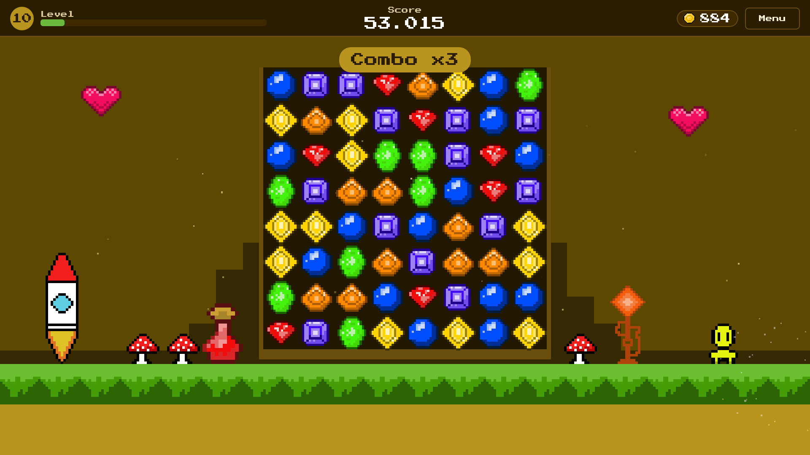
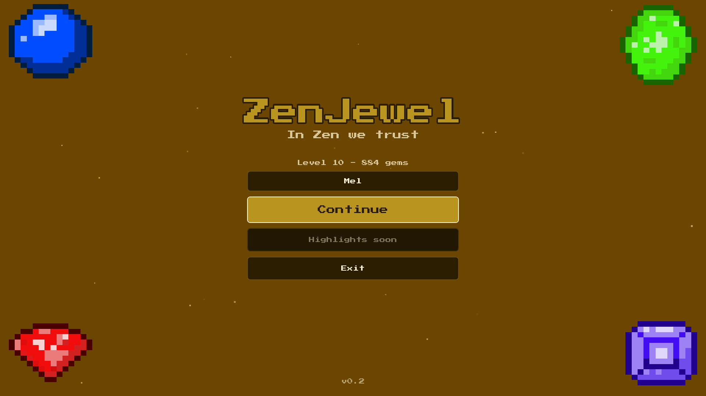
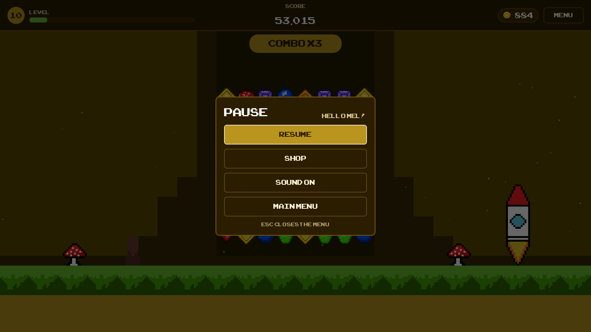
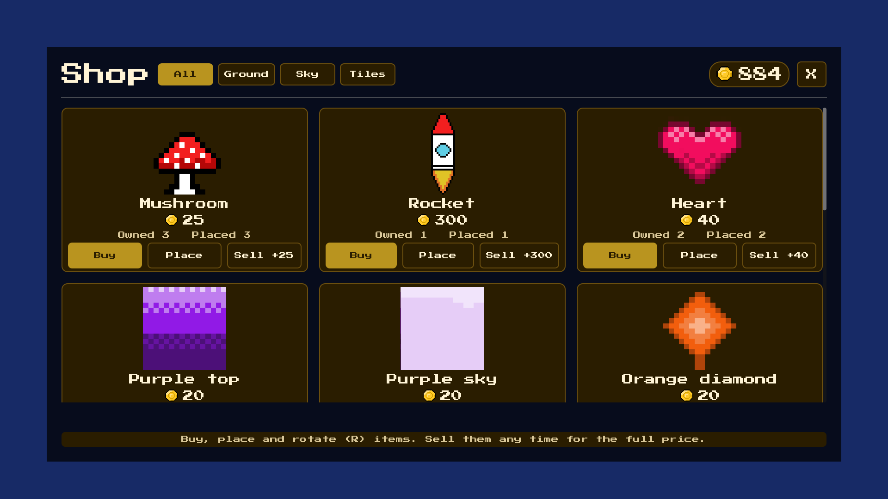

# ZenJewel

A relaxing match-3 puzzle game built with Godot 4. No timers, no lives, no stress.
Just play, match, and collect gems at your own pace.

**[Play it here](https://trancemeli.github.io/ZenJewel/)** (runs in your browser, no install needed)

<p align="left">
  
  
  <a href="https://trancemeli.github.io/ZenJewel/"></a>
  
  
  
  
  
</p>

---

## Preview



| Start menu | Pause menu |
| :---: | :---: |
|  |  |

| Shop |
| :---: |
|  |

## About

ZenJewel is a solo indie project built as a portfolio piece demonstrating full-stack game development: core engine programming, game systems design, pixel art, and original music production.

The design philosophy is **Zen Mode only**. No losing conditions, no time pressure. The player collects score and gems by matching jewels, levels up through score thresholds, and spends gems on decorations for the meadow in the in-game shop.

> All visual assets and music are currently in development. The screenshots and audio in this README will be updated as production progresses.

> **Cosmetics are not final.** The decorations in the shop are placeholders. Some of them come from other games that I am developing. I reserve the right to remove any of them again and to replace them with other ones at any time. Do not rely on a specific item staying in the game.

---

## Features

**Gameplay**

- 8×8 match-3 board with cascade combos and gravity
- The board sits in an open basin: jewels fall in from the top and land on a floor bar
- Safe board generation (no matches on start)
- Combo multiplier system with an on-screen combo counter
- Score and gems are based on the length of each matched row (3, 4, 5+)
- The board reshuffles automatically when no move is left, so you never get stuck

**Special Jewels** created automatically through larger matches

- Line H/V (4-match) clears an entire row or column
- Bomb (5-match) clears a 3×3 area
- Color/Rainbow (6+-match) clears all jewels of the same type

**Progression**

- Level system with scaling score goals (×1.4 per level), overflow points carry over
- Gem currency collected through matches
- Persistent save: score, level, gems, player name, sound setting, owned and placed decorations

**Shop and Decorations**

- Buy decorations with gems (mushroom, rocket, heart, potion, lamps, figures and tiles, more planned). The catalog is not final, see the note above
- Place items on the meadow or in the sky with a click or tap and turn them in 90° steps
- Items snap onto the meadow or onto the top of other items, so you can stack them (a potion on a mushroom)
- Edit mode: drag any placed item to a new spot, rotate it, or put it back into the inventory
- Sell items again at any time and get the full price back in gems
- Items stay where you put them between sessions
- All cosmetics are purely visual, no gameplay advantage

**Interface**

- Start menu with continue, optional player name and saved progress
- HUD with level badge and progress bar, score, gems and a menu button
- Pause menu (Esc) with resume, shop, edit meadow, sound toggle and main menu
- Interface text is in English, set in the Press Start 2P pixel font
- Runs in the browser on desktop, phones and tablets (landscape), with a rotate hint in portrait

**Visual & Audio** _(in development)_

- Pixel-style particle effects: jewel pops, special bursts, level-up confetti, ambient motes on the meadow, shop sparkles and dust puffs
- Line flash, bomb burst and jewel highlight effects
- Original soundtrack produced in FL Studio
- Original pixel art assets created in Aseprite

---

## Controls

| Action                    | Input                              |
| ------------------------- | ---------------------------------- |
| Select and swap jewels    | Left click two neighboring jewels  |
| Open or close the menu    | `Esc` or the Menu button           |
| Place a decoration        | Click or tap on the field (placing mode) |
| Rotate a decoration       | `R` or the Rotate button           |
| Move a decoration         | Menu, Edit meadow, then drag it    |
| Put a decoration back     | Edit mode: select it and press Put back, or right click |
| Sell a decoration         | Shop, Sell button (full refund)    |
| Leave placing or edit mode | `Esc` or the Done button          |

---

## Tech Stack

| Tool               | Purpose                |
| ------------------ | ---------------------- |
| Godot 4 (GDScript) | Engine and scripting   |
| Aseprite           | Pixel art assets       |
| FL Studio          | Music and sound design |
| Affinity Designer  | UI layout and mockups  |
| VS Code            | Code editing           |
| Press Start 2P     | Interface font (SIL OFL) |

---

## Project Structure

```
res://
├── assets/
│   └── cosmetics/         Images for shop decorations
├── font/                  Press Start 2P and its license
├── main_menu.gd           Start menu logic
├── scene/
│   ├── main_menu.tscn    Start screen
│   ├── main.tscn         Main game scene
│   ├── jewel0-5.tscn     Standard jewel scenes
│   ├── jewel_bomb.tscn   Special jewel scenes
│   ├── jewel_line_h.tscn
│   ├── jewel_line_v.tscn
│   ├── jewel_color.tscn
│   └── ui.tscn           HUD, pause menu and level-up overlay
└── script/
    ├── board.gd           Board coordinator, input locks, scoring
    ├── board_effects.gd   Visual effects
    ├── board_gravity.gd   Falling and refill logic
    ├── board_ui_bridge.gd UI and LevelManager connection
    ├── match_finder.gd    Pure match detection logic
    ├── special_handler.gd Special jewel activation
    ├── special_types.gd   Shared Special enum
    ├── jewel.gd           Jewel data and input
    ├── level_manager.gd   Score, level, gems, cosmetics, settings (Autoload)
    ├── cosmetics.gd       Catalog of decorations
    ├── decorations.gd     Placed decorations, placing mode and edit mode
    ├── shop.gd            Shop overlay
    ├── ui.gd              HUD and pause menu logic
    ├── ui_style.gd        Shared colors and button styles
    ├── fx.gd              Particle effect helpers
    └── main.gd            Scene root, decorations and ambient effects
```

---

## Architecture

ZenJewel uses composition over inheritance. `board.gd` acts as a coordinator and delegates to specialized modules:

```
board.gd  (coordinator)
├── match_finder.gd     stateless pure logic, receives grid, returns matches and run lengths
├── special_handler.gd  activation logic for all 4 special types
├── board_effects.gd    visual only, particles via fx.gd and Tween effects
├── board_gravity.gd    falling animation and refill
└── board_ui_bridge.gd  connects LevelManager signals to UI labels

LevelManager  (Autoload)
└── saves and loads score, level, gems, name, sound, owned and placed
    cosmetics to user://save.json (debounced, written atomically)

Cosmetics     (global class_name)
└── catalog of decorations: name, price, image or atlas region, scale, category

Decorations   (created by main.gd)
└── draws placed items, runs placing mode and edit mode (drag, rotate, snap)

SpecialType   (global class_name)
└── single source of truth for the Special enum
```

Overlays such as the pause menu, the level-up screen and the placing mode lock the board through a counter (`lock_input` / `unlock_input`), so they never interfere with a running cascade.

### Adding a decoration

Add an entry to `CATALOG` in `script/cosmetics.gd` with a name, price and category, plus either an atlas `region` in `assets/zenjewel_environment.png` or a `file` in `assets/cosmetics/` (optionally cropped with `region`) and a `scale`. The shop, placing mode and edit mode pick it up automatically.

---

## Planned Features

- Highlights screen (personal bests: highest score, longest combo, biggest match)
- More decorations, including items for the sky
- Alternative jewel skin themes and a skin manager for full visual theme switching

---

## License

This project and all its assets (code, art, music) may not be copied, modified,
distributed or used without explicit written permission from the author.

This does not apply to cosmetics that come from my other games. They are used here as temporary placeholders and may be removed at any time. I reserve all rights to them.

## Credits

- Built with [Godot Engine](https://godotengine.org) (MIT License).
- Font: [Press Start 2P](https://fonts.google.com/specimen/Press+Start+2P) by The Press Start 2P Project Authors, licensed under the SIL Open Font License 1.1, see `font/OFL.txt`. The license above covers the game's code, art and music, not the font.
